# 07 · DNS & Attack Surface Recon (OSINT)

> Mapped external attack surfaces through **DNS enumeration**, **certificate-transparency data** and **technology fingerprinting** to identify subdomains and publicly exposed services.

**Tools:** Shodan · SecurityTrails · DNS Recon · crt.sh

This repo is a **step-by-step tutorial** of my reconnaissance practice. It starts with *passive* OSINT (no contact with the target), then moves to DNS enumeration against a deliberately misconfigured practice domain, then Internet-wide search with Shodan.

> ⚠️ **Scope and ethics.** Passive OSINT uses public information, but active steps (zone-transfer attempts, brute-forcing, port scans) must only target systems you own or are authorised to test. For DNS practice I used **`zonetransfer.me`**, a domain published by DigiNinja specifically for learning zone transfers. Third-party host details in my Shodan screenshots are **blurred**, and I don't name real organisations.

---

## Contents

1. [Recon methodology](#1-recon-methodology)
2. [Passive footprinting a company](#2-passive-footprinting-a-company)
3. [DNS fundamentals](#3-dns-fundamentals)
4. [DNS enumeration lab](#4-dns-enumeration-lab)
5. [Certificate transparency and subdomain discovery](#5-certificate-transparency-and-subdomain-discovery)
6. [Shodan: Internet-wide exposure search](#6-shodan-internet-wide-exposure-search)
7. [Build the attack-surface map](#7-build-the-attack-surface-map)
8. [Staying anonymous (OPSEC)](#8-staying-anonymous-opsec)
9. [Defender takeaways](#9-defender-takeaways)
10. [Lessons learned](#10-lessons-learned)

---

## 1. Recon methodology

**Footprinting** is secretly gathering information about a target to build a *digital blueprint*: IP ranges and domains, network structure, servers, e-mail systems, employee names and e-mail formats, and physical locations.

| | Passive | Active |
|---|---|---|
| Contact with target | **None** | Direct interaction (probes) |
| Noise | Low | Higher, can be logged and alerted on |
| Examples | Search engines, WHOIS, Shodan, certificate logs, job posts | Zone-transfer attempts, DNS brute force, port scans |

Rules I follow:

- **Get information from multiple sources using multiple tools** and cross-check it.
- Verify every claim yourself. Don't paste AI output into a report as fact.
- Many security tools treat many requests from one IP as an attack, so rate-limit yourself.
- Record everything in a mind map (I use **XMind**): company → domains → subdomains → IPs → services → technology → risks.

---

## 2. Passive footprinting a company

My exercise targeted a publicly listed industrial-automation company (details anonymised here). The checklist and what each step produced:

| Item | How I found it | Example of the answer |
|---|---|---|
| Company profile, services, scope (global or country) | Company site, annual reports, press | Automation, SCADA and OT-security services |
| Acquisitions / mergers | News, filings | Important because acquired brands bring **extra domains** into scope |
| Official site and FQDN | Browser, WHOIS | Regional and parent-brand domains both exist |
| Domain age and registrar | **WHOIS** | 15+ years |
| Hosting provider and country | IP lookup | Cloud provider; CDN edge in another country |
| CDN / WAF / load balancer | Netcraft, browser extensions, response headers | CDN in front, with WAF and reverse proxy |
| Technologies | **Wappalyzer**, BuiltWith | WordPress, PHP, analytics, JS libraries |
| Server location and coordinates | IP geolocation | Edge-server location, *not* the company's own |
| Internal gear (routers, NGFW, NTP) | Passive OSINT | **Not discoverable**, and I recorded it as "not public" |

### What I learned along the way

- **A CDN hides the origin.** The visible IP belongs to the CDN's edge, so its geolocation says nothing about the company. A CDN also gives the target a WAF, which makes it a tougher target.
- **Geo-IP databases disagree.** I compared three providers for the same IP: country, city and ASN matched, but the *postal code differed between them*. Treat geolocation as approximate and cite the source and date.
- **Some subdomains aren't behind the CDN.** A scan of the domain's subdomains showed several hosts with the CDN proxy **off**, exposing their real (cloud) IPs: a direct route around the WAF.
- **Technologies ≠ versions.** Fingerprinting tools gave me products (e.g. jQuery, a CMS SEO plugin, an analytics platform) but no versions, so I could not map them to CVEs. I recorded the versions as *unknown* and made a "to verify" list, in priority order: CMS core and plugins → front-end libraries → analytics → TLS and server headers.
- **Why subdomains matter:** they often get *less* security than the main site, and large companies can have hundreds (one well-known manufacturer has 900+).

---

## 3. DNS fundamentals

A PC needs the **IP** of a destination server, and DNS provides it, starting from the root, then the TLD (`.com`), then the domain's name servers.

| Record | Purpose |
|---|---|
| **A / AAAA** | Hostname → IPv4 / IPv6 address |
| **NS** | The domain's authoritative name servers |
| **MX** | Mail servers for the domain (with priority) |
| **TXT** | Free text: SPF, DKIM keys, site-verification tokens |
| **CNAME** | Alias to another name |
| **SOA** | Zone metadata: primary NS, admin contact, serial, timers |
| **SRV / PTR / HINFO** | Service location / reverse lookup / host info |

### Mail authentication (shows up in TXT records)

- **SPF**: a TXT record listing the servers *allowed* to send mail for the domain
- **DKIM**: signs a message with a private key; the **public key is published as a TXT record**, proving the content wasn't altered
- **DMARC**: the policy that says what to do when SPF/DKIM fail ("the police officer")

Mail flow: `sender PC → SMTP (port 25) → sender's mail server (MTA) → SMTP → recipient's MTA → POP3/IMAP → recipient's PC`. The **MX record** finds the mail server and the **A record** finds its IP.

For recon, DNS records leak **infrastructure**: mail providers, third-party SaaS, internal naming, forgotten hosts.

---

## 4. DNS enumeration lab

**Target:** `zonetransfer.me` (an authorised practice domain). **From:** Kali Linux.

### 4.1 Find the name servers and SOA

```bash
dig -t ns zonetransfer.me
dig -t ns zonetransfer.me +short
dig -t soa zonetransfer.me +short
host -t mx zonetransfer.me
```

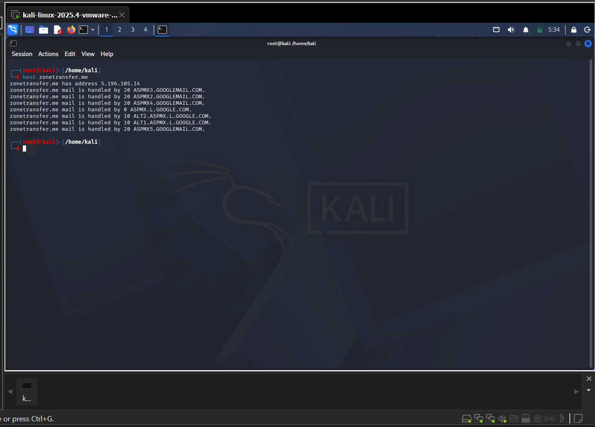
*`host -t mx` shows the domain's mail handled by several mail servers with different priorities.*

### 4.2 Attempt a zone transfer (AXFR)

A **zone transfer** copies the *entire* DNS zone from a name server. It's meant for secondary DNS servers only. If the primary allows it to anyone, you get the full host inventory in one request:

```bash
dig axfr @nsztm1.digi.ninja zonetransfer.me
```

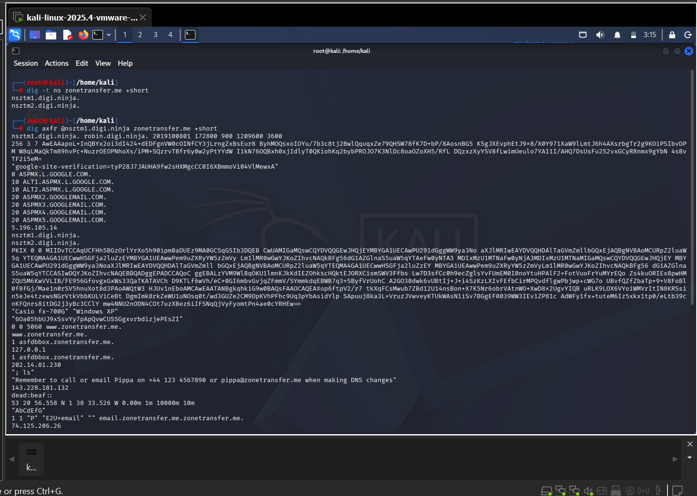
*The whole zone comes back: SOA, NS, MX, A, AAAA, TXT, CNAME, SRV and more.*

The same check works from a browser with no tools at all:

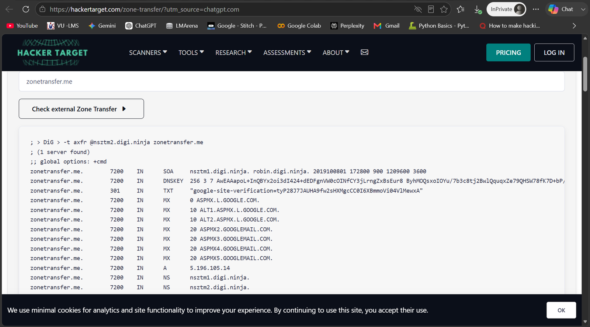
*HackerTarget's "Check external Zone Transfer" returns the same data as `dig`.*

And from Windows using `nslookup`, in interactive mode:

```
nslookup
> set type=ns
> zonetransfer.me
> server nsztm1.digi.ninja
> ls -d zonetransfer.me
```

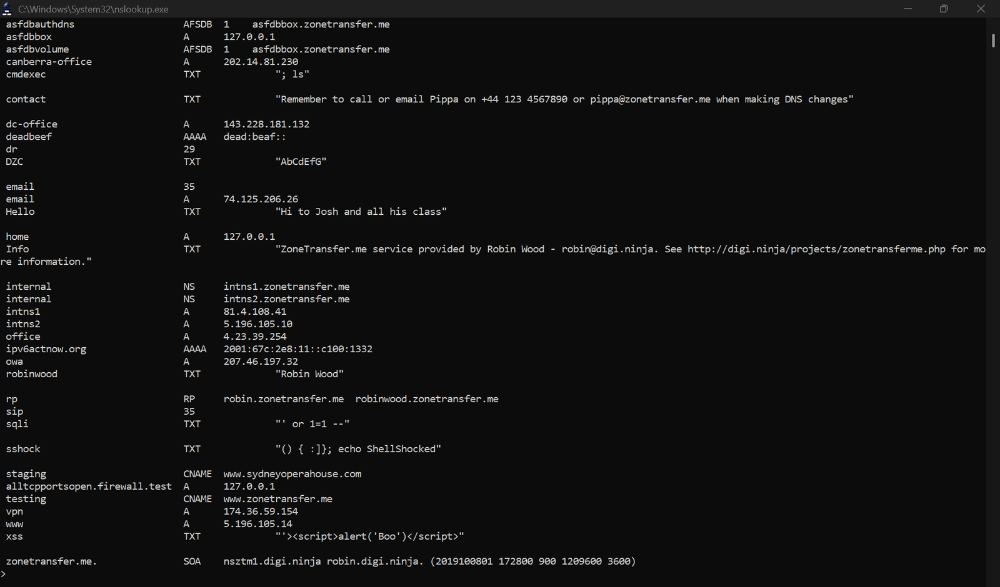

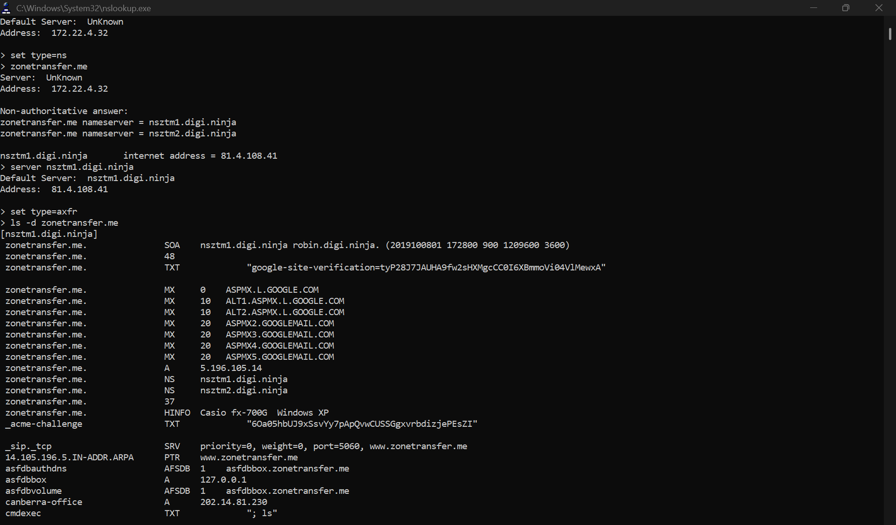
*Query the NS records, select the server that allows transfers, then `ls -d` dumps the zone.*

**Notable records in the dump**

- Hostnames that aren't meant to be public, such as `internal`, `intns1`, `office`, `staging`, `vpn`, `dc-office`, `canberra-office`.
- An `AFSDB` record, a `HINFO` record naming an old OS, and SRV entries.
- **TXT records carrying hostile test strings** (an XSS snippet, a SQL-injection fragment and a Shellshock string). This domain is built to show that DNS data is *attacker-controlled input*: if a dashboard or log tool renders TXT records without sanitising them, it can be attacked.

### 4.3 Automated enumeration

```bash
dnsenum zonetransfer.me
dnsrecon -d zonetransfer.me
nmap --script dns-brute zonetransfer.me
```

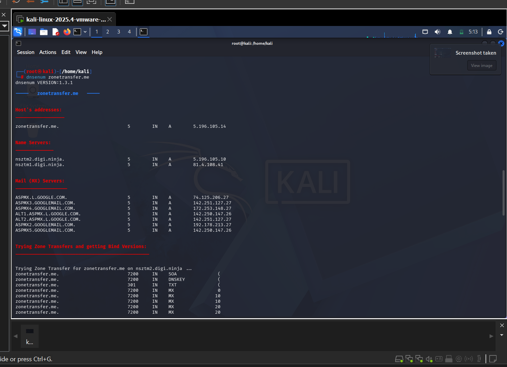
*`dnsenum` finds the host address, name servers and mail servers, then **tries a zone transfer against each name server**.*

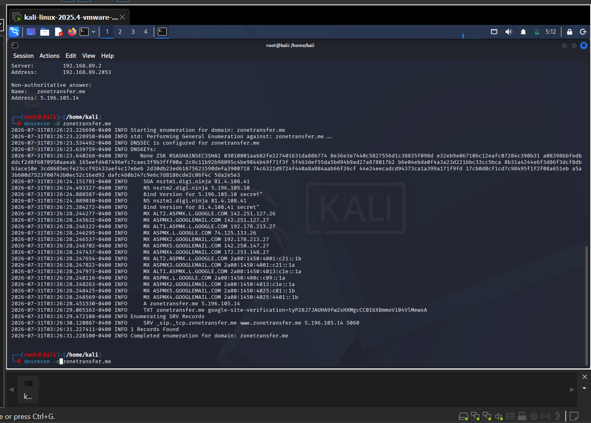
*`dnsrecon` enumerates the standard record types and also tests for zone transfer.*

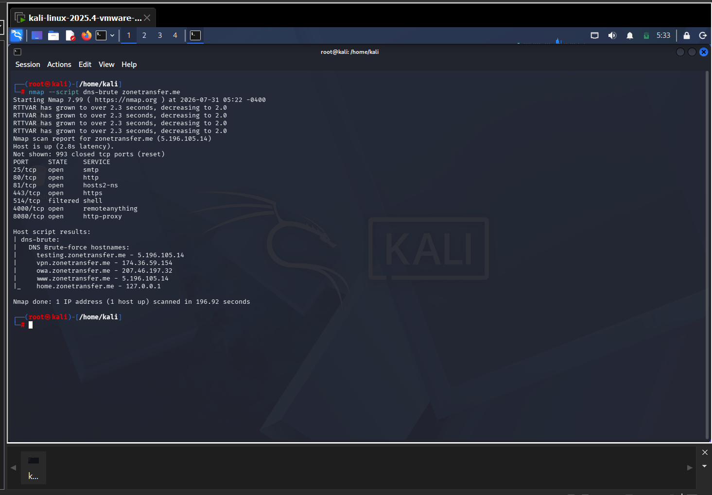
*Nmap's `dns-brute` script guesses common hostnames and resolves them. It found `testing`, `vpn`, `owa`, `www` and `home` (note `home` resolves to `127.0.0.1`). The same scan lists open ports 25, 80, 81, 443, 4000 and 8080.*

### Finding the right level of "noise"

Zone-transfer attempts and brute-force lists are **active** (they hit the target's DNS servers) and may be logged. For real engagements you start with passive sources (section 5) and only escalate within the agreed scope.

---

## 5. Certificate transparency and subdomain discovery

Every publicly trusted TLS certificate is recorded in public **Certificate Transparency (CT) logs**. Certificates list their hostnames, so CT logs reveal subdomains, including internal-looking or forgotten ones, **without touching the target**.

### crt.sh

Search `%.example.com` in the crt.sh web UI, or from a terminal:

```bash
curl -s "https://crt.sh/?q=%25.example.com&output=json" \
  | jq -r '.[].name_value' | tr -d '*' | sort -u > subdomains.txt
wc -l subdomains.txt
```

Tips: strip wildcards (`*.`), de-duplicate, then resolve the list to find which names are alive (`dnsx`, `massdns`, or a simple `for` loop with `dig +short`).

### SecurityTrails (and similar)

SecurityTrails gives **current and historical DNS**: subdomains, record history, previous IPs and associated domains. Historical DNS is especially useful to find the **origin IP behind a CDN** (the IP that served the site *before* the CDN was added).

### Why use more than one

| Source | Best for |
|---|---|
| crt.sh | Subdomains that ever had a TLS certificate |
| SecurityTrails | DNS history, associated domains |
| Subdomain finder / asset finder tools | Quick wide coverage |
| Zone transfer / brute force | Only where authorised; may find un-certificated hosts |

Combine the results, de-duplicate, then check each name's IP, CDN status and technology.

<!-- TODO: add crt.sh and SecurityTrails result screenshots to images/ and embed them here -->

---

## 6. Shodan: Internet-wide exposure search

**Shodan** is a search engine for **internet-connected devices**. It scans the Internet continuously and stores each device's *banners* (what a service says about itself), so you can find exposed systems **without scanning them yourself**. Its data refreshes every few days, so a result can be out of date.

### Search filters I practised

| Filter | Example | Use |
|---|---|---|
| `country:` / `city:` | `apache city:"Tokyo" port:8080` | Where |
| `port:` | `port:21` | Service/port |
| `os:` | `os:"Linux" country:KR port:21` | Operating system |
| `product:` / `version:` | `product:"Apache Tomcat" version:"9.0.39"` | Exact software and version |
| `net:` | `net:203.0.113.0/24` | A network range |
| `geo:` | `geo:"51.5074,-0.1278"` | Coordinates |
| `org:` | an organisation's name | Everything an organisation exposes |
| `ssl.cert.expired:true` | | Expired TLS certificates |
| `http.favicon.hash:` | | Hosts sharing a favicon (finds look-alike or related assets) |
| `vuln:` | `vuln:CVE-2021-22986` | Hosts affected by a CVE (**paid plan only**) |

### Searches and results

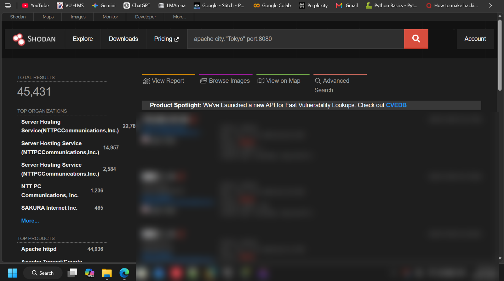
*Product + city + port: 45,431 results. (Host details blurred.)*

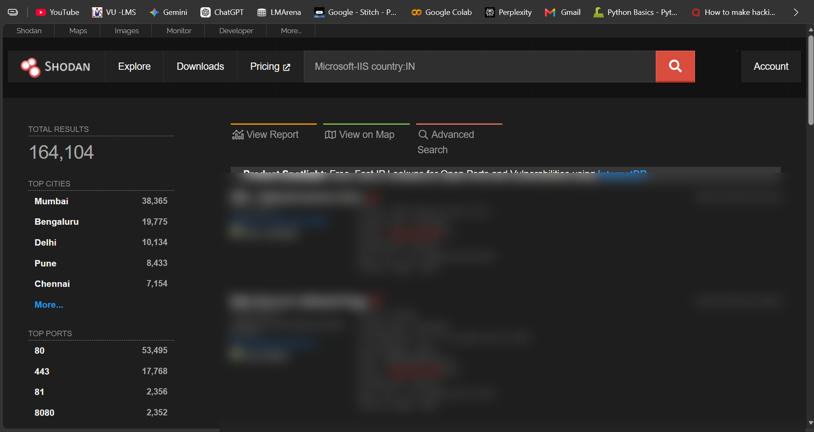
*`Microsoft-IIS country:IN`: 164,104 results. The left panel summarises **top cities** and **top ports** (80, 443, 81, 8080), a quick way to see how a technology is deployed.*

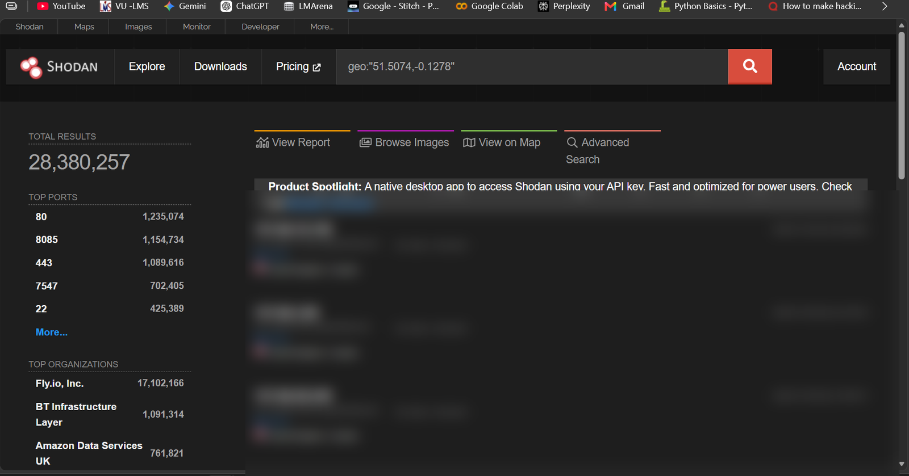
*Geographic search by latitude/longitude.*

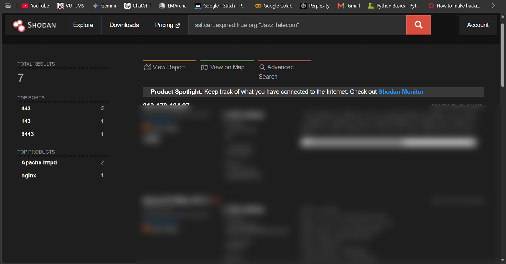
*Expired-certificate search for one organisation (7 results), a sign of poor certificate hygiene.*

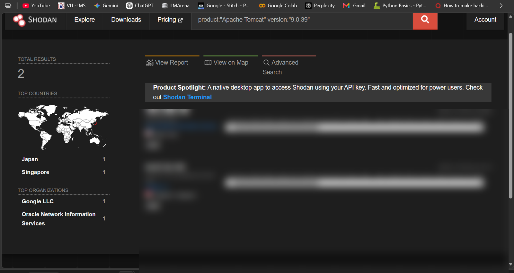
*An exact product/version query that matches only a couple of hosts. This is how attackers find servers running a vulnerable build, and how defenders check their own exposure.*

### Limits I ran into

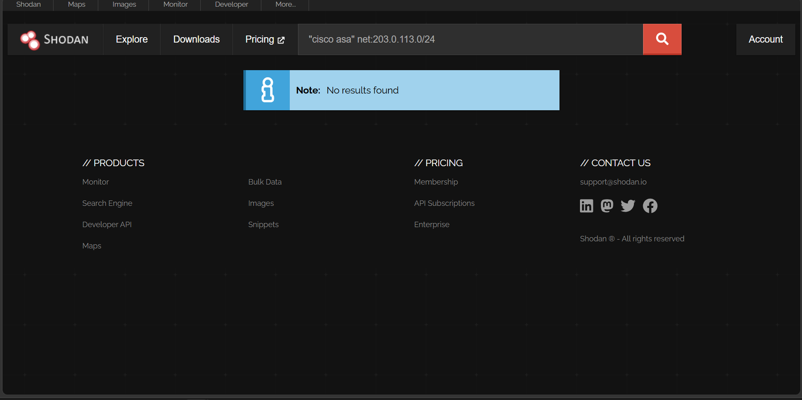
*A network-range query returning "No results found". A good outcome when checking your own range.*

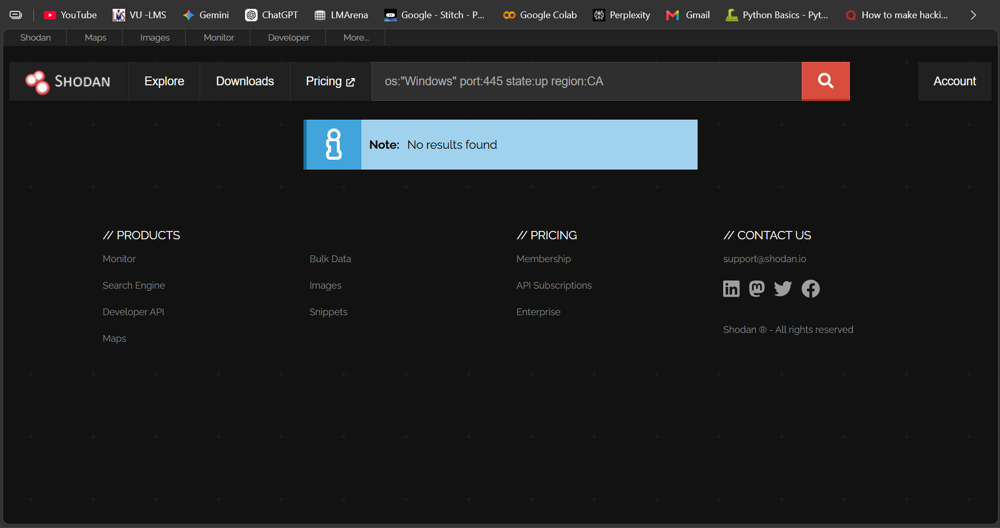

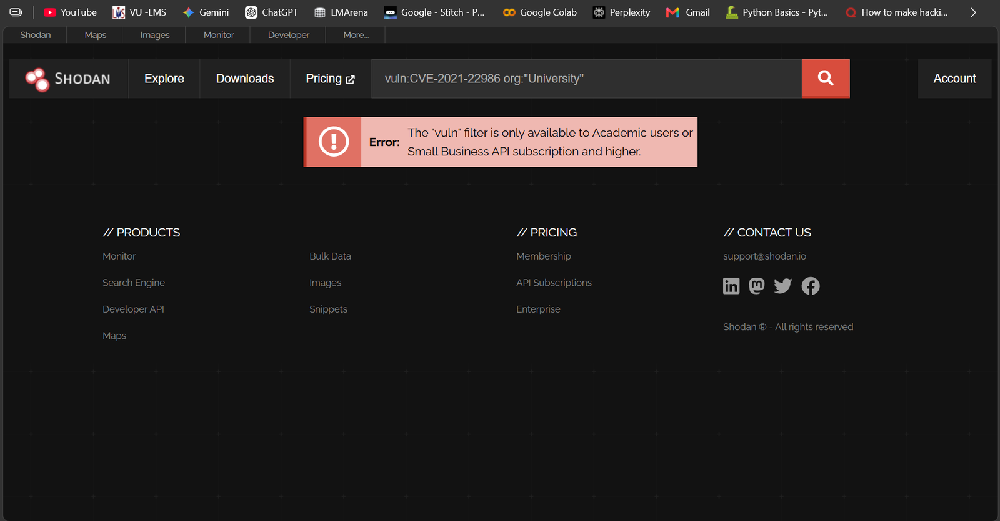
*The **`vuln:` filter is only available to Academic / Small Business or higher** accounts, so on a free account CVE hunting means searching by product and version instead.*

Other limitations: free accounts get limited results and credits, the data may be several days old, and a missing result **doesn't prove** a host is safe.

### Defending against Shodan

You can't stop Shodan from *scanning*, so reduce what it can *see*:

- close or firewall every service that doesn't need the Internet (especially RDP, SMB, databases, admin panels, camera/IoT interfaces)
- put management interfaces behind a VPN or allow-list
- remove or change revealing **banners** and default pages; patch exposed software
- monitor your own ranges (Shodan Monitor or scheduled `net:`/`org:` queries) and alert on anything new

---

## 7. Build the attack-surface map

Everything feeds one inventory:

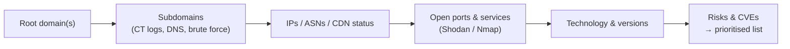

| Subdomain | IP / hosting | CDN/WAF? | Ports / services | Technology | Risk note |
|---|---|---|---|---|---|
| `www` | Cloud provider | Yes | 80, 443 | CMS + plugins | Version unknown → verify |
| `app` | Cloud provider | **No** | 443 | Unknown | Origin IP exposed |
| `legacy` | Own range | No | 21, 80 | Old FTP/Apache | Forgotten host → investigate |

*(Illustrative layout. The real data is kept private.)*

Prioritise what the Internet can reach, especially hosts **outside the CDN/WAF**, forgotten subdomains, and services with known-vulnerable versions.

---

## 8. Staying anonymous (OPSEC)

Active lookups reveal your IP to the target and to the sites you query. For research I use an isolated VM and the **Tor Browser**, then check the circuit.

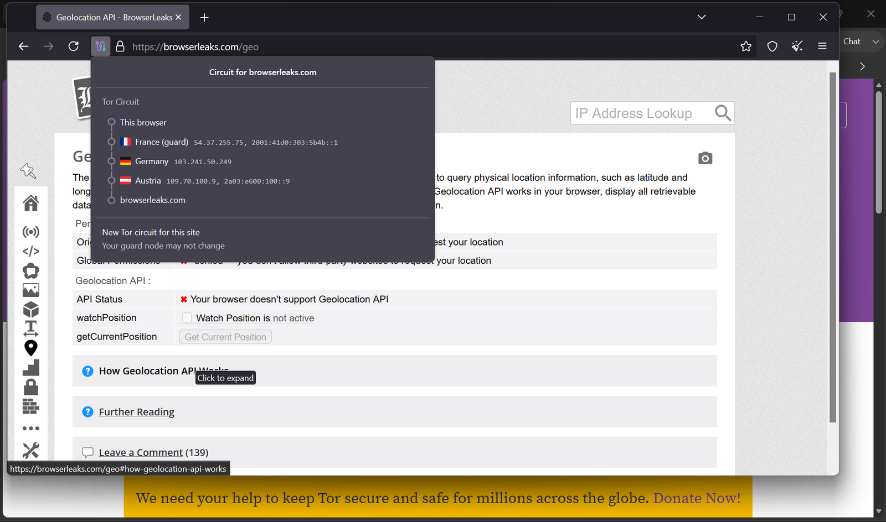
*Tor circuit for a test site: entry guard → middle → exit relay, across different countries.*

Remember that Tor and VPNs hide your *source IP*, not your *behaviour*. Stay within authorised scope regardless.

---

## 9. Defender takeaways

1. **Restrict zone transfers** to your secondary name servers only (`allow-transfer { <secondary-ip>; };` in BIND, plus TSIG authentication).
2. Use **split-horizon DNS** so internal names (`vpn`, `intranet`, `dc-…`) never appear in public zones.
3. **Review CT logs and DNS** for your own domains regularly; delete stale records and **dangling CNAMEs** (subdomain-takeover risk).
4. Keep CDN/WAF proxying **on for every public hostname**, and don't expose origin IPs.
5. **Search Shodan for your own ranges**, close what shouldn't be public and patch what must be.
6. Publish **SPF, DKIM and DMARC** correctly to stop domain spoofing.
7. Treat DNS data as **untrusted input** in any tool that displays it.

---

## 10. Lessons learned

- **Passive first.** CT logs, WHOIS and public indexes give you a lot before you send a single packet at the target.
- **Cross-check everything.** Different geo-IP databases, and different tools, give different answers.
- **Fingerprints aren't versions**, and without versions there is no CVE mapping.
- **Misconfigured DNS is a goldmine**: one open zone transfer can replace hours of guessing.
- **CDNs help defenders but don't remove the need to hide the origin.**
- **Document scope and sources**, so the work is repeatable and defensible.

---

*OSINT and DNS practice performed against public data and an authorised practice domain.*

[Browse more of my work on GitHub ↗](https://github.com/UsamaAhmad360?tab=repositories)
